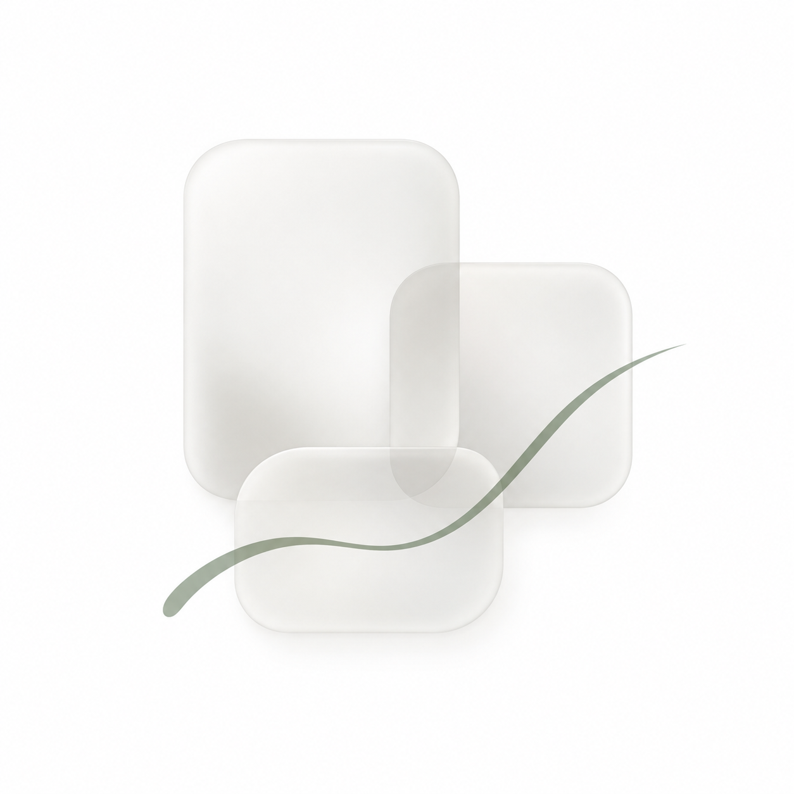
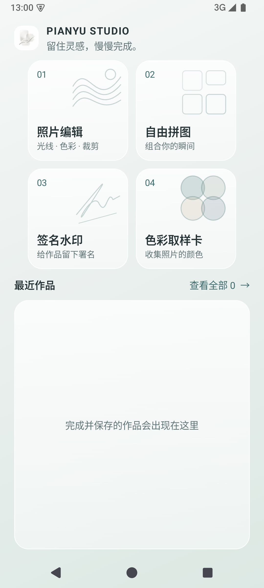
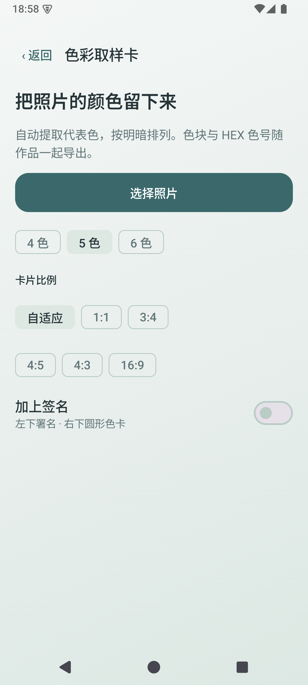
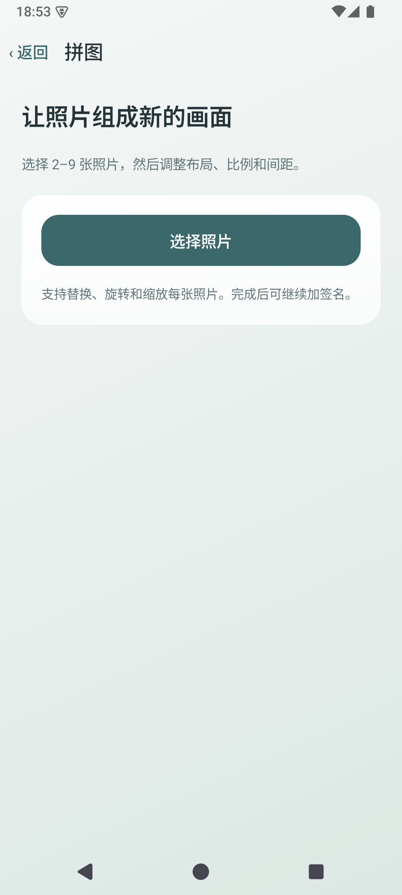
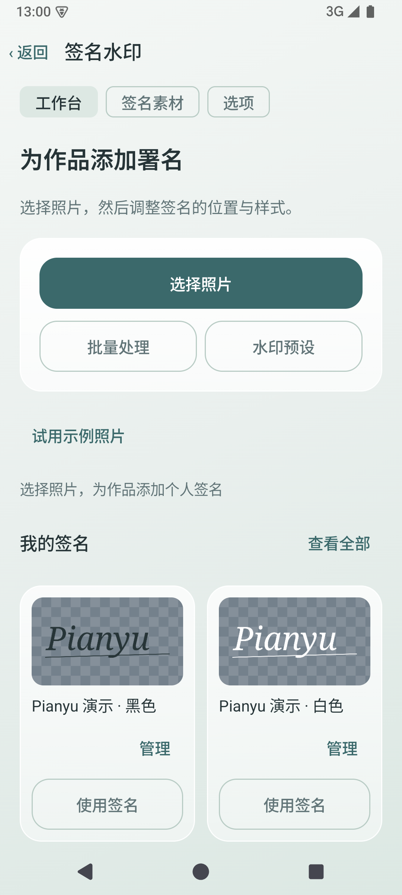

<div align="center">



# Pianyu Studio · 片屿工作室

**留住灵感，慢慢完成。**

一款将创意编辑、自由拼图、签名水印与色彩取样整合在一起的 Android 创作工具。

白色磨砂界面 · 本机处理 · 统一创作流程

[下载预览版](https://github.com/jingkunxiong-crypto/Pianyu-Studio/releases/tag/v0.4.0-preview) · [功能介绍](#四种创作方式) · [构建说明](#从源码构建)

</div>

## 四种创作方式

| 功能 | 可以做什么 |
| --- | --- |
| 创意编辑 | 局部留彩与相机画幅：保留照片局部色彩，或制作带相机屏幕和柔和背景的摄影卡片 |
| 自由拼图 | 将 2–9 张照片组合排版，调整成品比例和内部间距，裁切或替换单张照片 |
| 签名水印 | 手写、提取和管理透明签名，为照片署名，支持批量处理 |
| 色彩取样卡 | 从照片提取 4–6 种代表色，生成圆形色块与 HEX 色号组成的配色卡 |

### 从照片到作品，一套连贯的交互

- 固定首页：四个带功能线条图案的圆角入口，2 × 2 排列，无需滚动寻找工具。
- 统一视觉：浅色磨砂面板、灰绿色强调色、清晰的正文与说明层级。
- 连贯动效：开场图标归位、页面进入与返回过渡、按钮按压反馈和拼图面板切换。
- 最近作品：最新作品置顶叠放，点击进入完整列表；记录最近 30 个已保存作品。
- 统一调节：胶囊形滑轨与椭圆拖动块，保留各项调节范围和步进。
- 连续创作：创意编辑保存后可回到主页或再做一张；最近作品和拼图导出可继续添加签名。

### 创意编辑 · 局部留彩

选择照片后，背景转为黑白，选定区域保留原色。支持矩形、圆形、圆角矩形、星形、心形和菱形；可以拖动、双指缩放，并调整矩形宽高比和圆角大小。

默认按原图分辨率导出 JPEG，编码质量为 80（不是将像素或文件大小缩减到 80%）。保存时进入独立进度页，完成后提供“回到主页”和“再做一张”。修复返回首页后新选照片被旧编辑状态覆盖的问题。

### 创意编辑 · 相机画幅

将照片与相机背面组合成画幅：上方展示照片，下方是照片色彩生成的柔和背景及相机屏幕中的缩略图。支持照片旋转、画幅比例、填满或完整显示、拖动构图和背景柔和程度。焦距与光圈可从照片 EXIF 读取，也可以手动修改；相机型号手动填写。默认 PNG 无损分块导出，也可选择 JPEG 质量 80；画幅按旋转后的照片宽度生成。PNG 适合大图，JPEG 导出需要更多内存。

### 色彩取样卡

提供自适应、1:1、3:4、4:5、4:3、16:9 卡片比例；完整容纳照片，底部排列圆形色块及 HEX 色号。

开启签名时，署名位于左下角，色块排列于右下角。直接共用应用内签名水印模块的签名库，无需重复创建；色卡中使用深色墨迹。接近纯色的照片可能提取到少于设定数量的颜色。

## 界面预览

以下为 0.1.0 版本的实际 Android 模拟器截图，用于展示整体风格。0.2.0 已将首页“照片编辑”替换为“创意编辑”，并更新滑轨样式；截图尚未更新。

<table>
<tr><th>创作首页</th><th>色彩取样卡</th></tr>
<tr><td></td><td></td></tr>
<tr><th>自由拼图</th><th>签名水印</th></tr>
<tr><td></td><td></td></tr>
</table>

## 安装

1. 前往 [Releases](https://github.com/jingkunxiong-crypto/Pianyu-Studio/releases)。
2. 下载 `Pianyu-Studio-v0.4.0-preview.apk`，在 Android 手机上打开安装。
3. 如系统询问，允许当前下载来源安装应用。

支持 **Android 8.0（API 26）及以上**。此版本为 **debug 签名的预览版**，不是应用商店正式版。Release 同时提供 SHA-256 校验文件。

内置签名为通用的 **Pianyu 演示字样**，不包含作者个人签名。

## 隐私与保存

照片、配色提取和签名处理在设备本地完成，当前应用未声明网络访问权限。通过系统照片选择器读取用户选择的图片；保存时生成新作品，不覆盖原图。Android 8–9 保存到相册时需要存储权限。

签名库是 Pianyu Studio 应用内部共享的库；不会自动读取其他独立应用的私有数据。旧签名可以通过透明 PNG 导入。

## 从源码构建

- 安装 Android Studio、JDK 25（Gradle Daemon 配置指定版本）、Android SDK Platform 37。
- 项目使用 Kotlin、Jetpack Compose、Material 3，Gradle Wrapper 9.4.1，Android Gradle Plugin 9.2.1。
- 在 Android Studio 中打开仓库根目录，设置本机 SDK 位置并同步 Gradle。

Windows：

```powershell
.\gradlew.bat assembleDebug
```

macOS / Linux：

```sh
chmod +x gradlew
./gradlew assembleDebug
```

输出：`app/build/outputs/apk/debug/app-debug.apk`。

本机 SDK 路径、构建缓存、签名密钥与临时工作目录不纳入版本控制。

## 版本状态

`0.4.0-preview`：相机画幅新增照片旋转与 PNG 无损分块保存。模拟器使用约 5000 万像素的合成照片完成 PNG 导出，并检查照片方向与 WebP；不同手机及实际大文件仍需进一步验证。

`0.3.0-preview`：新增相机画幅，已在模拟器上预览并检查保存。此预览版使用 Debug 签名；大图和不同品牌真机仍需进一步验证。

`0.2.0-preview`：已完成本地 Debug 构建。JPEG 导出在小米 25019PNF3C 上完成了 1200 万像素合成图的部分性能检查：处理及编码约 0.43 秒，原 PNG 流程约 2.28 秒（不含选图导入与相册登记）。这些单次数据不代表所有照片；5000 万像素与完整方向回归测试尚未取得完成结果。最新胶囊滑轨已编译，尚未在设备上检查外观。未覆盖不同品牌真机、系统版本和大字体的完整兼容性测试。

欢迎通过 Issues 提交问题，并附上系统版本、操作步骤和截图。

## 项目来源

整合片屿、Geyi、Signature Watermark Studio 的创作能力，并统一主题与入口。依赖及来源说明见 [THIRD_PARTY_NOTICES](docs/THIRD_PARTY_NOTICES.md)。
